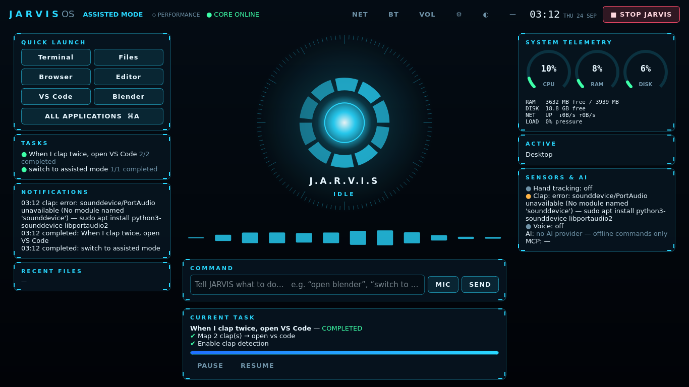
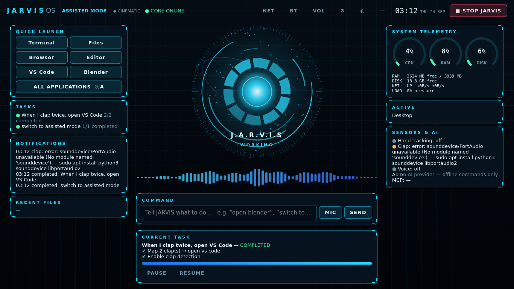
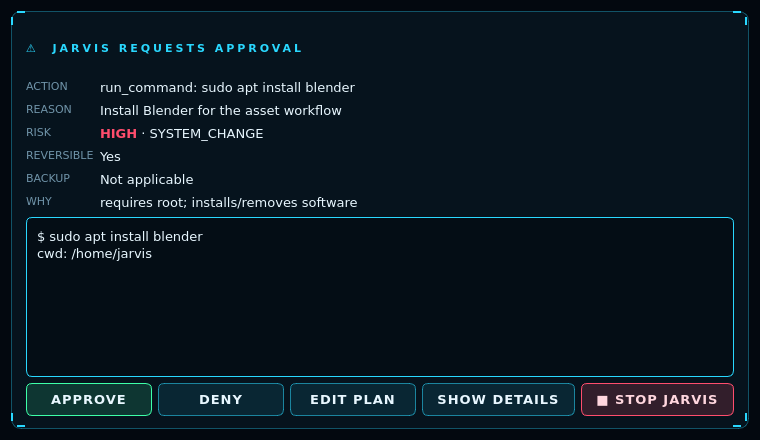
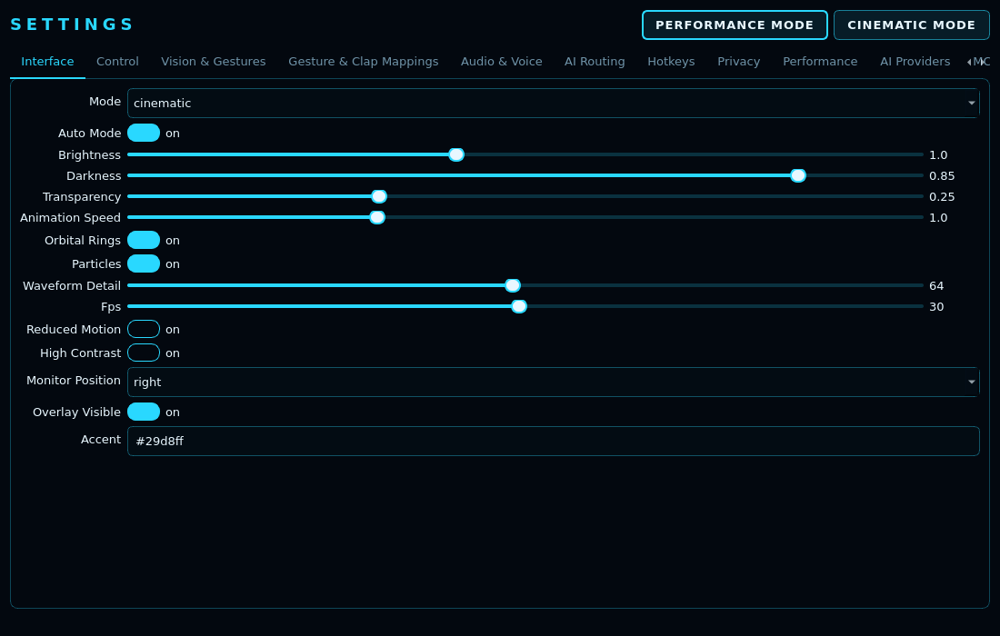
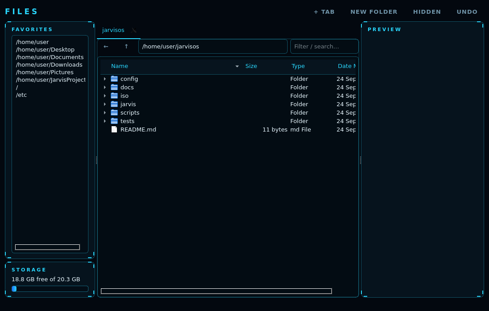

# JARVISOS

A lightweight Debian-based Linux desktop with a JARVIS AI control layer on top. It targets low-end
laptops (4 GB RAM, older Intel CPU, integrated graphics).

JARVIS takes a request and runs this loop: **understand → plan → pick tools → act → observe → verify → recover**.
Every action goes through the same permission, approval and audit pipeline, whether it came from text,
voice, a hand gesture, a clap, an MCP tool or the AI planner. You stay the final authority, and
**STOP JARVIS** (button / `Ctrl+Super+Esc` / `jarvis stop`) halts everything.

| Performance mode | Cinematic mode |
|---|---|
|  |  |

| Approval dialog | Settings | Files |
|---|---|---|
|  |  |  |

*(These screenshots were rendered offscreen from the real code by `scripts/render-ui.py`. They are not mockups.)*

## Quick start

```bash
# 1. Build the bootable ISO (Debian host with network access to deb.debian.org)
./install-dependencies.sh
./build-iso.sh                        # → out/jarvisos-<rev>-amd64.iso + .sha256
./test-iso.sh                         # headless QEMU boot + in-session self-test
./run-qemu.sh                         # interactive VM (disposable disk, never your real disks)

# 2. Or run JARVIS on an existing Debian/Ubuntu desktop for development
pip install -r requirements-dev.txt   # or: apt install python3-pyqt5 python3-psutil python3-numpy
python3 -m jarvis.cli daemon &        # the core
python3 -m jarvis.cli hud --window    # the HUD
python3 -m jarvis.cli do "switch to cinematic mode"
python3 -m jarvis.cli repl
```

## Architecture

```
jarvis/
├── core/            config (validated schema, backups, history) · safety (risk, policy, permissions,
│                    approvals, emergency stop) · audit (redacting JSONL) · memory/tasks · intents
│                    (offline NL parser) · tools (single side-effect choke-point) · agent (plan/execute/
│                    verify/repair loop) · vision_agent (screenshot→batch→verify) · runtime (wiring + socket API)
├── computer_control/ apps (.desktop discovery + launch) · actions (PyAutoGUI batches: validation,
│                    dry-run, retries, ESC cancel) · system (terminal, windows via wmctrl/xdotool, trash, telemetry)
├── vision/          gestures (21-landmark classifier, swipes, confirmation+cooldown, custom-gesture
│                    training, camera loop) · screen (capture, local OCR, target finding)
├── audio/           clap (onset + spectral detector, adaptive noise floor, sequences) · voice (Vosk offline, espeak)
├── ai/              providers (OpenAI-compatible + Gemini adapters, templates, secret store) · router
├── mcp/             JSON-RPC client (stdio + streamable HTTP), registry with risk classification, bundled server
├── apps/            workflows: Blender (bpy), Unreal (Python commandlet), browser (Playwright), recipes
├── desktop/         Qt5 HUD, approval dialog, launcher, settings, file manager, text editor, shared theme
├── cli.py · daemon.py
iso/                 live-build config: package lists, hooks, Openbox/LightDM/systemd/hotkey config
tests/               118 automated tests
```

The control hierarchy is enforced by the planner prompt and the tool catalogue: **app API → official CLI →
MCP → browser automation → PyAutoGUI → vision-guided PyAutoGUI**.

## Status report

These categories are strict. "Tested" means an automated test in `tests/` exercises the feature and passes.

### COMPLETED AND TESTED (118 passing tests, run in this sandbox)
- **Configuration.** Schema validation, defaults, safe fallback for invalid or corrupt files, versioning,
  import/export, reset, backups and restore, change history, 0600 permissions, hardware-aware profile,
  performance/cinematic presets.
- **Natural-language settings (offline, no AI needed).** All the example phrases from the spec: modes,
  brightness, transparency, rings, FPS, clap sensitivity/timing, monitor position, gesture and clap
  mappings, disabling specific gestures, control-mode switching.
- **Safety.** Command and path risk classification (disks, EFI, bootloader, auth and security are CRITICAL
  and *always* ask, even in FULL mode). SAFE/ASSISTED/AUTONOMOUS/FULL policies, revocable permissions,
  approval broker (synchronous and asynchronous), emergency stop interrupting waits, commands and batches.
- **Audit log.** Covers every stage. Secrets (API keys, bearer tokens, passwords) are redacted. Search,
  export, clear, and per-category disabling.
- **PyAutoGUI engine.** Schema validation, coordinate bounds, blocked hotkeys, size limits, dry-run text,
  retries, stop-on-failure, ESC/STOP cancellation. Tested against a fake backend.
- **Agent.** Rule-based and LLM planning, step execution, retry of transient errors, LLM repair/replan,
  step limit (no infinite loops), cancellation, persistent task state, honest failure reporting.
- **File operations.** Trash-based delete with undo, backup before write, write verification, root paths
  requiring approval.
- **Gestures.** Open palm, fist, pointing, 1/2/3/4 fingers, thumbs up/down, pinch, 4 swipes, multi-frame
  confirmation, per-gesture cooldown, no repeat while held, disabled mappings, custom-gesture
  train/match. Tested on synthetic landmarks.
- **Claps.** Single/double/triple, timing window, cooldown, debounce, calibration, rejection of loud
  low-frequency sounds and faint noise. Tested on synthetic audio.
- **Universal action router.** Gestures and claps route through the same permission system, and a
  gesture mapped to a shell command still requires approval.
- **AI providers and routing.** OpenAI-compatible and Gemini request/response formats (text + image),
  templates (Gemini, OpenRouter, Mistral, Hugging Face, OpenAI, Ollama, llama.cpp), custom endpoints,
  per-slot models, keys never exposed, router preferences and fallback, offline mode, clear
  "no provider" message.
- **MCP.** A real stdio round-trip against the bundled server: initialize, list, call, READ/WRITE/DELETE/SEND
  classification, disabled tools, missing-argument validation, broken-server handling.
- **App discovery.** Parses `.desktop` files (hidden/broken entries skipped), aliases, fuzzy matching, and
  official install hints for missing apps.
- **Fallbacks.** Missing camera/OpenCV, missing microphone/PortAudio, no display for screenshots and no AI
  provider all degrade without crashing the core.
- **Daemon socket API and CLI client.**
- **UI (offscreen Qt).** The HUD starts both offline and online, sends commands that change settings, and
  refreshes. Settings writes config, the file manager opens, and the editor saves (with backup).
- **ISO tree static checks.** Scripts parse, required packages are present, heavy desktops are absent,
  build scripts contain no host-disk commands.

### IMPLEMENTED BUT NOT FULLY TESTED
- **Live hardware paths.** Real PyAutoGUI on X11, wmctrl/xdotool window control, the MediaPipe camera
  loop, the sounddevice mic loop, Vosk voice and espeak feedback. The code is written against the real
  APIs, but this sandbox has no display, camera or microphone.
- **Vision-guided GUI loop** (`vision_task`) and the `screen` tool with a real vision model. This needs
  an API key and a display.
- **Blender bpy asset generator** (voxel PBR blocks, lighting, camera, `.blend` + FBX export) and the
  Unreal Python import. The recipe and the honest "not installed" path *are* tested. Blender and Unreal
  themselves are not.
- **Playwright browser automation, streamable-HTTP MCP transport, keyring storage.**
- **Global hotkeys** (xbindkeys → `jarvis-hudctl`), the Openbox "below" layer rule for the HUD, LightDM
  autologin, the jarvisd systemd user service with memory limits.

### BLOCKED (in this build environment)
- **Building and booting the ISO.** The sandbox cannot reach any Debian mirror (deb.debian.org, snapshot,
  ftp and kernel mirrors all refuse connections), so `lb build`, `test-iso.sh` and QEMU could not run.
  The full pipeline (`build-iso.sh`, live-build config, hooks, serial-console boot marker, in-session
  self-test, checksums) is written and statically tested, but **no ISO has been produced yet, and no
  boot has been verified.** Run `./build-iso.sh && ./test-iso.sh` on any Debian 12 machine with network
  access.

### PARTIALLY IMPLEMENTED
- **Installer.** `JARVIS_INSTALLER=live ./build-iso.sh` adds the stock Debian installer, and
  `./run-qemu.sh --install` tests it on a fresh disposable qcow2 disk. There is no JARVIS-styled installer.
- **Accessibility API (AT-SPI) control.** at-spi2-core is shipped, but there is no dedicated AT-SPI
  tool yet. The fallback is CLI → PyAutoGUI.
- **Cloud speech-to-text adapter.** This is gated behind `audio.cloud_stt_allowed`, and the adapter is a stub.
- **Custom-gesture training UI.** The capture and training engine is done and tested. The guided dialog
  in Settings is not.
- **Lock-screen styling.** Only the LightDM greeter colours are themed.

### PLANNED
A JARVIS-styled installer, an AT-SPI tool, the gesture-teaching wizard, per-app plugin workflows
(GIMP/Krita/Godot/OBS scripting), and RAM/CPU benchmarks measured on real 4 GB hardware.

See `docs/` for the user, developer, security, performance and troubleshooting guides.
